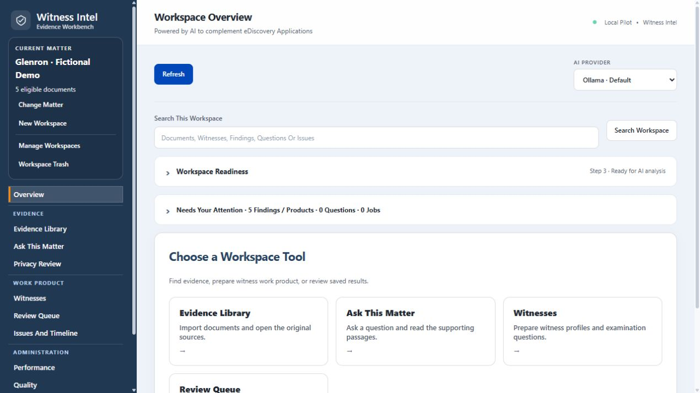
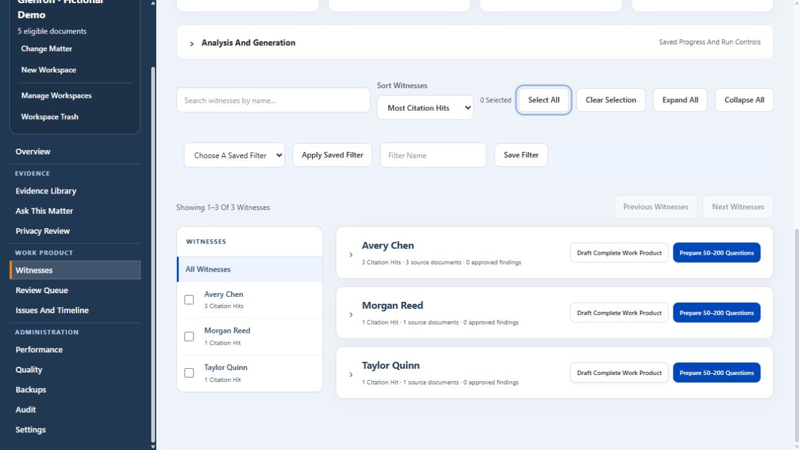
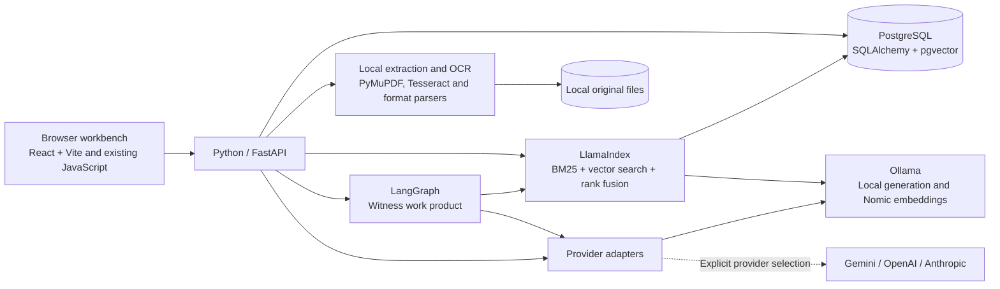

# Witness Intel

Powered by AI to complement eDiscovery Applications

Witness Intel is a local Windows workbench for reviewing eDiscovery evidence, finding potential witnesses, and drafting examination questions. Start from a document or a question, then follow the citation back to the source passage.

**Status: runnable pilot, not a production or privacy-compliance certification.** Requires local PostgreSQL and configured model/OCR services. No live client corpus or provider call is included in automated tests.

| Workspace overview | Witness ranking |
| --- | --- |
|  |  |

The screenshots use a fictional matter with five sample documents and seeded witness findings. [See the cited Ask This Matter result](docs/screenshots/03-ask-this-matter.png).

## Technology stack

[Low-level design](docs/ARCHITECTURE.md) covers evidence ingestion, search, validation, job recovery, and the database model.

## Features

- Browser folder upload and any backend-accessible folder-path import, with per-file progress and saved inventory.
- Local extraction and PDF/image OCR; per-file failure inventory.
- Deterministic PII/PHI-pattern masking, matter-specific tokens, custom sensitive terms, optional human privacy review before AI egress, off by default with a Settings control.
- Ollama by default; Gemini, OpenAI and Anthropic Claude can be selected explicitly. No automatic fallback.
- OpenAI (ChatGPT models) and Anthropic Claude are selectable for extraction, witness work product and question drafting. [Provider setup](docs/PROVIDERS.md) covers API keys, model selection and synthetic connection tests in Settings.
- Settings model selection and synthetic Gemini connection tests; safe provider diagnostics, bounded retries, resumable analysis batches and per-passage verified checkpoints.
- Evidence-linked proposed witnesses, chronology and relationships; exact quote and chunk-ID verification; attorney claim approval.
- Separate AI support-review pass before proposed findings are published; this reduces risk but does not prove factual correctness.
- Deposition/trial, direct/cross, alignment and leading/open-ended question options.
- Inquire-inspired witness cards with profile summaries, chronology/relationship tables, clickable source-review dialogs, CSV exports and editable/paginated question outlines targeting 50–200 questions.
- PostgreSQL persistence for matters, documents, chunks, runs, evidence outputs and audit records.
- Workspace JSON export; configuration templates and secret scanner.
- Recoverable workspace Trash, individually/bulk confirmed permanent purge with pending-cleanup recovery, and select-all document privacy approval that preserves source text/checkpoints.

## Start

Follow [the runbook](docs/RUNBOOK.md) to create the PostgreSQL database, install Python dependencies and Tesseract, configure `.env`, and initialize the schema. Then run `scripts/start.ps1` and open http://127.0.0.1:8765.

Read [the user guide](docs/USER_GUIDE.md), [architecture and privacy design](docs/ARCHITECTURE.md), and [format coverage](docs/FORMATS.md) before importing evidence.

For a fictional 500-document energy-accounting investigation with a separate answer key, see [Glenron testing](docs/GLENRON_TESTING.md). The generator, validator and importer are included; generated evidence remains in ignored local data storage.

The optional [Enron benchmark](datasets/enron/README.md) can be generated locally from the pinned CMU source. The fictional Glenron demo works independently.

The requested privacy targets and remaining obligations are recorded in [the privacy policy design](docs/PRIVACY_POLICY.md). Real-name review is optional unless the manual privacy gate is enabled in Settings.

## Boundaries

This pilot has no multiuser authentication, SSO, job queue, database-enforced matter authorization or tamper-proof audit store. Bind to loopback only. Do not expose it to a firm network. Automatic cross-document identity resolution, independently adjudicated support verification and automatic contradiction detection remain future work. Local vector retrieval and explicit reviewed identity merges are available. Exact quote matching and a second AI pass do not prove the correctness of an interpretation. All generated outputs require review.

Sensitive originals and database contents need operating-system access controls and encrypted disks/backups. Git exclusions are defense in depth, not a substitute for reviewing tracked files and repository history.

### Specialist witness drafts
The witness workbench now uses a LangGraph workflow for corpus research, readable cited profiles, possible factual/legal issue questions, chronology and examination drafts. Use **Draft complete work product** on an existing witness, or leave automatic work-product drafting enabled for new analysis batches. Drafts may use pending source-linked findings; attorney review remains required before final use. LlamaIndex combines local masked Nomic embeddings and PostgreSQL pgvector with BM25 keyword search and reciprocal rank fusion. LangGraph continues to orchestrate generation workflows. See `docs/USER_GUIDE.md` and the additive `migrations/002_local_embeddings.sql` upgrade instructions in `docs/RUNBOOK.md` before upgrading an existing database. Ollama is the default; cloud providers are selected explicitly. No external legal research or hosted tracing is enabled.

Local indexing now defaults to automatic server-side maintenance. Settings offers a persisted Manual mode and live current/remaining progress. The backend continues indexing active workspaces without a browser, resumes saved vectors after restart, and pauses around analysis.

Question drafting now includes a professional attorney editor and source-backed message context: identify an exhibit by ID and verified sender/date/recipients, then ask short cited follow-ups. Existing pending outlines offer **Improve document context**, preserving original wording and protecting approved or rejected questions.

Evidence review now preserves expanded lists and selections after review actions. The review panel supports selected-row decisions and bulk approval of pending evidence/questions by witness or workspace, with counted previews, acknowledgement, stale-selection protection and audit records. Privacy review and narrative-profile approval remain separate.

Sparse witness profiles now show a brief cited evidence digest and explicit limitations instead of raw first-person excerpts presented as a biography. Chronology explains when supported dated events are missing, while source findings remain available for inspection. Witness extraction checkpoint coverage is shown separately from indexing progress.

Witnesses now contains each person's Profile Summary, Relationships with Others, Chronology and cited Questions, including question settings and bulk evidence review. Separate Chronology, Relationships and Questions tabs have been removed.

On this configured Windows machine, double-click **Start-WitnessAI.bat** to start the existing local PostgreSQL database, Ollama if needed, the application in visible console windows, pgAdmin and a browser. See the Windows startup section in `docs/RUNBOOK.md` for private configuration and saved-login behavior.

Double-click **Stop-WitnessAI.bat** to close Workbench services and launcher consoles. Use `Stop-WitnessAI.bat -Check` for a read-only target preview; see the shutdown section in the runbook.

The [modern dashboard and export guide](docs/INTERFACE_AND_EXPORTS.md) covers collapsible panels, witness search and pagination, selected/all CSV exports, and combined or separate Word documents. Existing Settings color palettes remain available.

The Overview links to the main tools and the sidebar shows the current matter and document count. Open **Ask This Matter** to pick a prompt template or enter a question. Expand **Document Scope** to select specific documents. The tool drafts answers locally with Ollama from retrieved passages, shows how many passages it used, and opens each cited passage in the document reader. Download cited results as CSV or Excel. Answers remain drafts for review.

To rebuild the React interface after editing it, run `npm ci` and `npm run build` from `frontend`. FastAPI serves the built bundle from `app/static/react`, so normal desktop startup needs only the existing Python runtime.

### Performance tab

Open **Performance** in the sidebar. Start with **Active Jobs And Controls** to check job progress; expand **GPU Details**, **Services And Loaded Models**, **All System Processes**, or **Recent Job History And Errors** for details. Filter jobs to the current workspace or view all workspaces. Search processes by name or PID, filter by category, and sort by CPU or memory. Process CPU is normalized to total machine capacity.

The display checks for updates every five seconds while the tab and browser window are visible. Requests never overlap; slower samples delay the next update. **Pause Updates** freezes automatic refreshes, while **Refresh Now** always requests a fresh snapshot. The backend caches system snapshots for three seconds. Filters and expanded panels persist during updates.

Elapsed time includes waits and pauses. Recent speed and ETA require at least three observed progress changes over ten seconds. ETA is for the current stage, uses an approximate half-to-double range, and becomes unavailable after 90 seconds without completed units. This range is a heuristic, not a confidence interval. Accepted question counts are targets and may change during validation. Earlier jobs have recorded wall-clock durations, but no historical token-rate telemetry.

Full-corpus jobs support the existing pause, resume and cancel operations at safe boundaries. The selected job ID is checked, so an action cannot accidentally target a newer run. Standalone extraction, drafting, question and benchmark requests support cooperative controls while their server runtime is active. Use full-corpus parent controls for nested jobs. Interrupted requests created before saved-request tracking must be restarted explicitly from Witnesses. Completed checkpoints remain saved.

Process termination requires selecting a workspace for the audit record, a fresh preview, acknowledgement of possible data loss, and typing **TERMINATE <PID>**. Confirmations expire after 60 seconds and are single-use. Process identity, ownership and protection are checked again immediately before signalling. Application ancestors, database and known critical system services are protected; inaccessible and other-user processes cannot be terminated. Only the selected process is signalled, without elevation or tree termination. On Windows termination can immediately discard unsaved work. Prefer job controls for application workflows.

GPU telemetry uses the installed NVIDIA driver and `nvidia-smi`; unsupported values appear as unavailable. GPU process data covers NVIDIA compute processes, with per-process memory often unavailable on Windows. AMD and Intel telemetry is not currently supported. Cloud model execution does not use the local GPU. Service health checks do not call paid model APIs. Process command lines, environment variables, executable paths and model prompts are never collected by this monitor.

Telemetry references: [NVIDIA System Management Interface](https://docs.nvidia.com/deploy/nvidia-smi/) and [psutil](https://psutil.io/).

### Review, case organization, quality and recovery

- **Review** brings saved findings, work products and individual questions into one filterable queue. Inspect citations, edit question wording, and record review decisions. Version checks reject stale review submissions. Incomplete question checkpoints are labeled and can be reviewed after the generating job stops. Exports include these saved drafts with an incomplete label.
- **Witness Identity Review And Aliases** in Review requires an explicit same-person confirmation. It changes structured identity fields across saved outputs while preserving quotations, narrative wording, original files and review status. Decisions are audited with before/after snapshots. Undo refuses to overwrite payloads changed after the merge. Future extractions may introduce aliases again and require another review; there is no automatic fuzzy identity matching.
- **Case** organizes attorney-written issues, unanswered questions, supporting findings, contradicting findings and witness links. Edit issues with revision protection. The timeline uses supported saved event dates and labels undated events separately; it never invents dates or treats a message header date as proof of the described event date.
- **Quality** runs the frozen public Enron header/address/quote benchmark with the selected provider and recorded model. The evaluated model receives only public message text and a constant task, never the answer key. Source hashes are checked before each call. Compare equal sample sizes/reference versions; interrupted reports retain completed cases. Download a scorecard as JSON to retain predictions and provenance. Enron's reference does not establish legal roles, completeness of witness discovery or question usefulness.
- **Candidate Coverage Against Your Attorney Reference** accepts a separately reviewed expected-name list and scope note. It measures exact name coverage against source-grounded, non-rejected saved candidates by provider/model. Partial references do not classify additional names as false positives; precision is shown only after the operator confirms the reference covers the entire included corpus. This scoring-only reference is never sent to a model. Use attorney usefulness assessments for saved questions/work products; these record output revision and do not change approval status.
- **Performance** now offers Pause, Resume, Cancel and saved-request retry where supported. Controls take effect after an in-flight model request or validated batch; provider requests may finish and incur charges. Question batches are saved after validation and recovered only against unchanged claim revisions/equivalent source contexts for the same witness/provider/model. Recovery creates a new outline version with provenance and retains earlier outputs. Other retries create new workflow versions while retaining prior saved stages. Full-corpus runs retain their existing passage/witness checkpoint recovery. Server startup marks unfinished standalone requests interrupted; it never silently marks them completed or automatically resends private evidence.
- **Provider Metrics** in Quality measures model-call wall time, failures, HTTP attempts and returned token counts. Ollama generation speed uses reported generation duration. Missing usage is unavailable, not zero. User-entered per-million-token USD rates estimate all measured calls at the latest saved rates; caching, discounts and unreported retry usage can make invoices differ. There is no paid billing API request. Metadata measurements store no prompts, keys or model responses. Local saved job requests retain attorney instructions for explicit recovery.
- **Search This Workspace** searches document names, saved text, findings, questions, products and case issues. Search results link to the reader or review tools and never include other workspaces. Import, Witnesses, Review and Case have named saved filters. **Needs Your Attention** links to pending reviews and stopped jobs; marking a job addressed removes its reminder while retaining its status and history.
- The document reader displays PDF/image originals beside saved extracted text. Source citation links highlight matching quotations and select the cited PDF page when identifiable. PDF/image previews render locally as images, without executing imported HTML, macros or scripts. Masking/OCR/formatting may prevent highlights on the original. Other formats remain readable as saved text and downloadable as unchanged originals.

### Verified backup and restore

Use **Backups** to create a current-workspace backup or an all-workspace backup including Trash. Backups include originals, database records, embeddings, saved outputs, review/audit history, identity decisions, saved views, rate/quality annotations and resolved non-secret settings. Active/paused jobs block a consistent snapshot. Progress reports copying/hashing and final verification. Each original is checked against its recorded SHA-256 before the archive is published, and archived bytes are verified again. Saved local backups can be downloaded later.

Upload a backup ZIP to preview and verify it, then type **RESTORE AS NEW WORKSPACES**. Restore creates fresh workspace/document/job/output IDs and remaps structured references. It verifies original checksums and database relationships; existing workspaces are never overwritten, and restored jobs never start automatically. By default, non-secret global settings remain as audit snapshots. The explicit **Apply Non-Secret Global Settings To This Server** option restores the previewed palette, models, privacy-review and indexing settings atomically, while preserving existing server secrets. API keys, database credentials and privacy secrets are never included in the archive and must be managed separately.

Restore uploads are limited to 512 MB compressed and 2 GB expanded. Backups contain sensitive evidence and should be kept in an approved secure location. Local archives and restore staging are under ignored data storage, not Git. Restore is tested against isolated PostgreSQL schemas and local original files; it is a portable application backup, not a substitute for operational database disaster-recovery planning.

Provider metadata references: [OpenAI token usage](https://developers.openai.com/api/docs/guides/token-counting), [Claude Messages](https://platform.claude.com/docs/en/build-with-claude/working-with-messages), [Gemini usage metadata](https://ai.google.dev/api/generate-content#UsageMetadata), and [Ollama durations/token counts](https://docs.ollama.com/api/chat).

### LlamaIndex retrieval integration

Witness Intel uses `llama-index-core` 0.14.25 for retrieval and native asynchronous vector-index insertion. The existing parser, frozen source passages, document IDs, chunk IDs, locators and PostgreSQL `corpus_embeddings` table remain authoritative. No database migration or framework-specific vector table is needed. Compatible existing vectors are reused. Long passages now use a versioned, full-coverage windowed-embedding policy and are automatically reindexed; source passages and citation IDs stay fixed. Ordinary stale-source detection still schedules changed passages for indexing.

The pipeline is: source/privacy snapshot → masked `TextNode` → local Ollama `BaseEmbedding` adapter → guarded vector-store adapter → PostgreSQL pgvector. Search fuses a workspace-scoped BM25 retriever with LlamaIndex's `VectorIndexRetriever` using `QueryFusionRetriever` in reciprocal-rank mode. SQL always constrains the owning workspace and included documents. After retrieval, the server rechecks source and masking fingerprints before returning saved passage text and its existing citation identifiers. Repeated content from different sources retains distinct citation IDs.

The framework receives masked passage text; local identifier/locator metadata is excluded from embedding input. The Ollama endpoint remains loopback-only, the embedding model and prefixes remain `nomic-embed-text:latest` / `search_document:` / `search_query:`, and short passages retain the original fingerprint policy. Long passages use LlamaIndex character-bounded splitting (1,024 characters, up to 128 overlap), with normalized length-weighted pooling into one vector per original passage. Explicit context-limit failures trigger smaller local windows rather than truncation; the long-passage fingerprint records this algorithm version. Cloud embedding defaults, hosted parsing, query rewriting and framework answer synthesis are disabled. A retrieval-only LLM guard prevents fusion from resolving a default cloud LLM or generating queries. The established provider-selection, support-validation and attorney-review workflows continue to handle generation through LangGraph and application code.

Settings → **Local Corpus Search** shows the active framework version. Retrieval responses identify the engine and ranking method. Semantic-service failures retain local keyword search with an explicit warning. Retrieval continues to return a selected subset, not a declaration that the entire corpus has been reviewed.

Dependencies: use `uv pip install --python .venv/Scripts/python.exe -r requirements.lock.txt` for the pinned environment. The modular core dependency is used without installing cloud LLM/embedding integrations. Source: [VectorStoreIndex](https://developers.llamaindex.ai/python/framework/module_guides/indexing/vector_store_index/) and [QueryFusionRetriever](https://developers.llamaindex.ai/python/framework-api-reference/retrievers/query_fusion/).

## License

Original Witness Intel application code is available under the [MIT License](LICENSE). The bundled React runtime has its [own notice](frontend/LICENSE-REACT). Third-party datasets and dependencies retain their respective terms.
