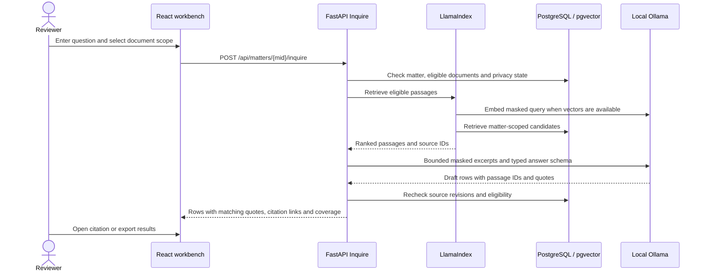
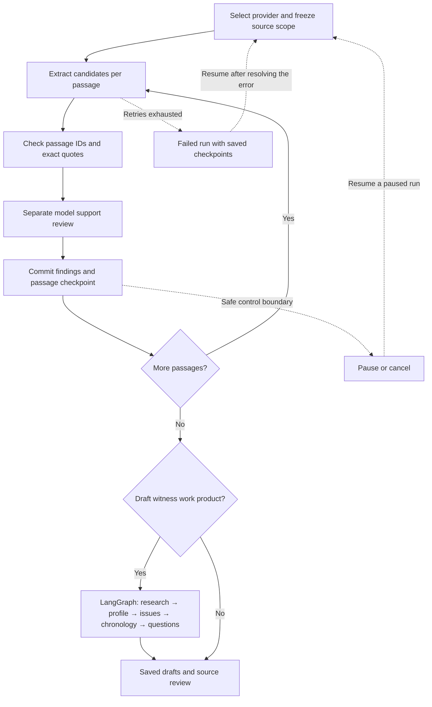
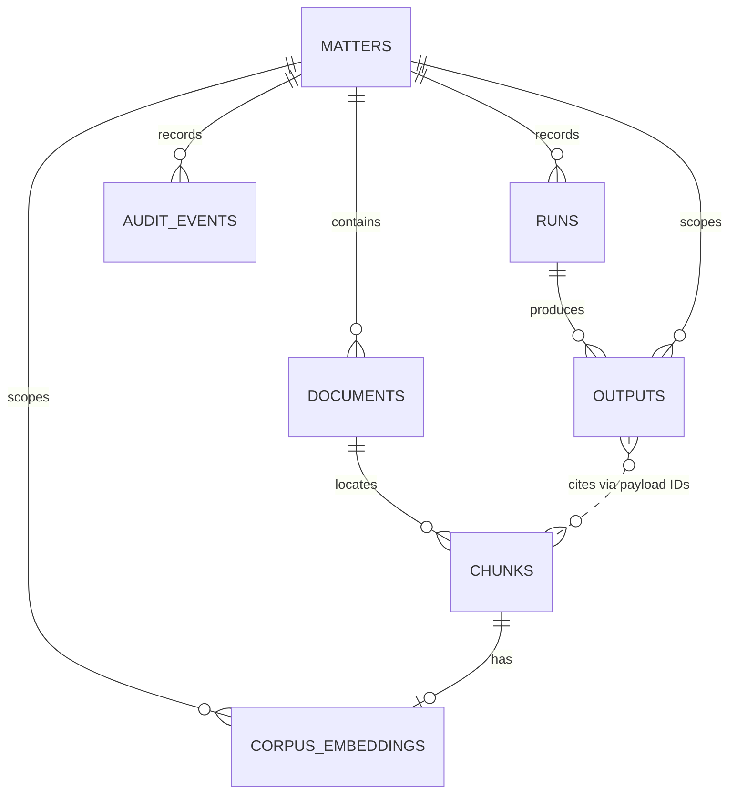

# Witness Intel low-level design

Witness Intel runs as a single local FastAPI process. It serves the built React navigation and research interface alongside JavaScript workbenches for import, witness work product, and review. PostgreSQL stores matter records and pgvector embeddings. Original files live under the configured local data root.

## Component responsibilities

| Component | Implementation | Responsibility |
| --- | --- | --- |
| Browser | [React shell](../frontend/src/App.jsx), [Ask This Matter](../frontend/src/Inquire.jsx), [workbench bridge](../app/static/react_bridge.js) | Matter selection, evidence scope, research, review and download controls |
| API and persistence | [main.py](../app/main.py), [migrations](../migrations/) | Local origin checks, matter scoping, SQLAlchemy records, imports, reviews and settings |
| Parsing and masking | [extract.py](../app/extract.py), [privacy.py](../app/privacy.py) | Parse text and OCR supported files locally. Mask detected identifiers and configured terms before segmenting text |
| Index and retrieval | [indexer.py](../app/indexer.py), [retrieval.py](../app/retrieval.py), [LlamaIndex adapters](../app/llama_retrieval.py) | Maintain vectors and rank eligible passages with BM25, exact pgvector cosine search and reciprocal rank fusion |
| Research answers | [inquire.py](../app/inquire.py) | Scope and bound evidence, ask local Ollama for typed results, check quotations, open citations and export |
| Witness workflow | [workproduct.py](../app/workproduct.py), [question_context.py](../app/question_context.py) | Orchestrate research, profile, issues, chronology and question drafting. Validate edits against saved evidence and revisions |
| Jobs and providers | [full_corpus.py](../app/full_corpus.py), [job_runtime.py](../app/job_runtime.py), [providers.py](../app/providers.py) | Track runs, checkpoints, control requests and model attempts. Route configured structured model calls |
| Evidence review | [document_reader.py](../app/document_reader.py), [workspace_tools.py](../app/workspace_tools.py), [witness_exports.py](../app/witness_exports.py) | Open source documents, record reviewer decisions and export selected work |

## Evidence ingestion and indexing

1. A matter import inventories files, computes a SHA-256 digest, and skips a duplicate digest within the same matter. The app keeps a managed copy of each original and records parsing failures with the document.
2. Supported parsers and OCR extract text with locators. Masking applies to extracted text. Stable tokens are scoped to a matter, and originals remain available through the local reader.
3. The indexer produces masked Nomic embeddings with local Ollama. Long passages are embedded in overlapping windows and pooled into one vector per source passage. The source locator stays attached to the original passage.
4. Each vector records its source revision and masking fingerprint. Before writing or returning evidence, the app rechecks the current scope and fingerprints. Search can fall back to BM25 when semantic search is unavailable.

## Ask This Matter

The app discards rows with unknown passage IDs or quotes that cannot be matched in the supplied excerpt. A match confirms that the quote exists in the supplied text. The reviewer still assesses what the quote supports. Results report the retrieved evidence used for the question.

## Witness analysis and recovery

The full-corpus manager persists control and checkpoint state in PostgreSQL. The LangGraph workflow commits work-product stages through application code. Question edits check the current outline revision before committing. Job state and review state are distinct. For example, a completed run can produce questions that still need review.

## Core database relationships

| Record | Selected fields |
| --- | --- |
| Matter | Name, privacy mode, sensitive terms and instructions |
| Document | Matter ID, relative name, byte count, original SHA-256 and import status |
| Chunk | Document ID, locator, extracted text, privacy detections and approval |
| Run | Matter ID, provider, model, purpose, input manifest, prompt version and status |
| Output | Matter and run IDs, kind, typed JSON payload and review status |
| Audit event | Matter ID, actor, action and operation details |
| Embedding | Matter ID, unique chunk ID, model, fingerprint and 768-dimensional vector |

## Local boundary

Ollama is the default. Ask This Matter and vector embeddings use loopback Ollama. Extraction and witness drafting can use cloud providers when selected explicitly. Automatic masking and optional manual privacy review apply before model requests. The model receives bounded inputs and returns typed data. Application code controls file access, SQL writes, validation and review.

The app is a single-operator pilot. See [privacy design](PRIVACY_POLICY.md) for the masking limits and [the runbook](RUNBOOK.md) for local setup and upgrades.
